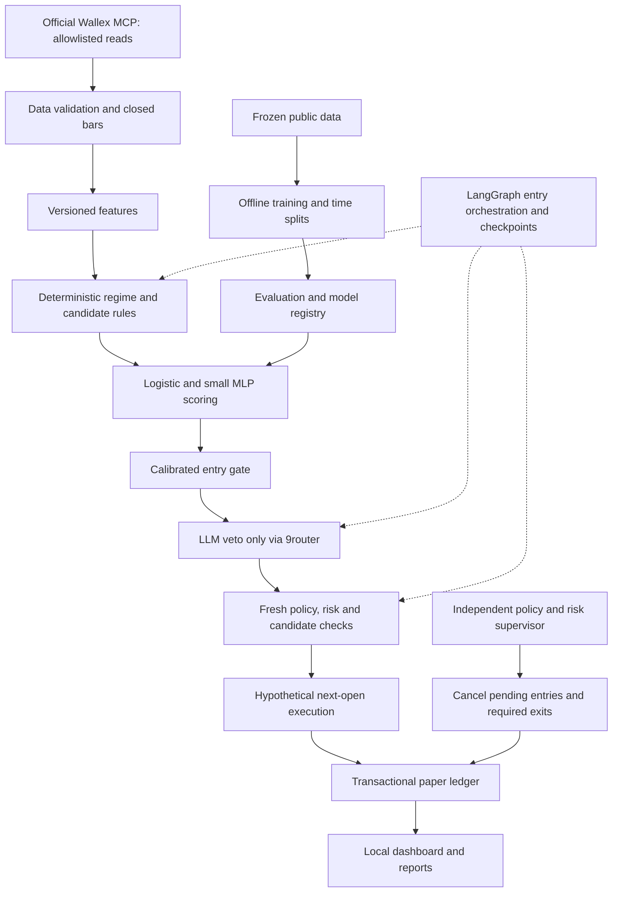

# طرح سیستم ایجنت ترکیبی والکس

وضعیت: **با دستور بعدی کاربر، مرحله پژوهش و آموزش آفلاین مجاز شد. معامله واقعی همچنان اجرا نشده و به اجازه بعدی و زیرساخت مستقل نیاز دارد.**

به‌روزرسانی دامنه: `hybrid_research.py` و `run_hybrid_research.py` پیاده‌سازی پژوهشی الگوریتم + Logistic + MLP + LangGraph + وتوی LLM هستند. گراف فعلی فقط تصمیم‌های آفلاین دارد؛ checkpoint زنده، supervisor مستقل عملیاتی و آداپتور معامله واقعی هنوز پیاده نشده‌اند. بخش‌های پایین، طرح اصلی‌اند و همه آنها ادعای قابلیت موجود نیستند.

تاریخ ثبت: ۱۴۰۵/۰۷/۳۰، برابر با ۲۰۲۶/۱۰/۲۲، منطقه زمانی Asia/Tehran.

این سند ابتدا صرفاً طراحی آینده بود. دستور بعدی کاربر، پیاده‌سازی و آزمایش تاریخی را مجاز کرد؛ اجرای واقعی پس از اجازه بعدی او مطرح می‌شود. موتور و پنل جاری برای این آزمایش تغییر نمی‌کنند. اجازه پژوهش یا پیاده‌سازی به‌تنهایی مجوز معامله واقعی نیست.

## ۱. تصمیم معماری پیشنهادی

یک برنامه محلی Python با ماژول‌های جدا و دفتر SQLite پیشنهاد می‌شود. الگوریتم‌های قطعی نامزد ورود می‌سازند؛ مدل‌های آماری و یک شبکه عصبی کوچک کیفیت نامزد را تخمین می‌زنند؛ LLM فقط حق وتوی نامزد پذیرفته‌شده را دارد. LangGraph جریان ورود و ثبت وضعیت را هماهنگ می‌کند. کنترل ریسک و خروج اجباری در مسیر مستقل از LLM، آموزش و پیشرفت گراف باقی می‌ماند.

هدف، سنجش مزیت پس از هزینه و تحویل نتیجه قابل بازپخش است. نبود معامله یک نتیجه مجاز است؛ نه نشانه سودآوری مدل. معماری چندمدلی تضمین سود یا برتری نسبت به نقد یا خرید و نگهداری نیست.

نسخه اول پیشنهادی: `ta_trend + Logistic baseline + small MLP + LLM veto + LangGraph + deterministic risk + paper ledger`. مدل در طول یک ارزیابی یا جلسه سایه ثابت است. آموزش آنلاین، عامل خودتغییردهنده و جست‌وجوی آزاد ابزارها وارد نسخه اول نمی‌شوند.

## ۲. الزامات غیرقابل تغییر چالش

مرجع نهایی [challenge_rules.py](../challenge_rules.py)، [فهرست ممنوعه](../rules/blocked_markets.txt)، [قواعد چالش](CHALLENGE_RULES.md) و برای cutoff فایل [competition.py](../competition.py) است. این سند جایگزین آنها نیست. در تعارض احتمالی با دیگر گزارش‌ها، این منابع و AGENTS.md حاکم‌اند.

| موضوع | الزام طراحی |
| --- | --- |
| سرمایه | آورده صفر؛ اعتبار و مبنای بازده دقیقاً ۵٬۰۰۰٬۰۰۰ TMN |
| شروع | ۱۴۰۵/۰۷/۲۹ ساعت ۲۰:۳۲ تهران؛ `2026-10-21T20:32:00+03:30` |
| انقضای اعتبار | ۱۴۰۵/۰۸/۰۲ ساعت ۲۰:۳۲ تهران؛ `2026-10-24T20:32:00+03:30`؛ حداکثر ۷۲ ساعت |
| پایان اجرای سایه | جمعه ۱۴۰۵/۰۸/۰۱ ساعت ۲۳:۵۰ تهران؛ `2026-10-23T23:50:00+03:30`؛ زودتر از انقضای اعتبار |
| کارمزد اعتبار | صفر TMN برای همین طرح؛ مستقل از کارمزد معاملات |
| کارمزد معاملات | نرخ جاری حساب باید با منبع و زمان ثبت شود؛ نرخ تنظیمی یا گزارش تاریخی، تأیید نرخ فعلی نیست |
| بازار | canonical normalization و رد همه نمادهای denylist در backend، engine و MCP؛ فایل فهرست بدون به‌روزرسانی صریح کاربر تغییر نمی‌کند |
| دسترس‌پذیری بازار | نبودن در denylist کافی نیست؛ داده جاری و کیفیت بازار باید جدا بررسی شود |
| قابلیت ممنوع | اهرم/تعهدی، بات بومی والکس، واریز، برداشت، انتقال و فعال‌سازی/توقف/تمدید خودکار طرح |
| اجرا | فقط paper/shadow؛ اسپات و معامله آنی در سطح طرح مجازند، اما آداپتور معامله واقعی در این نسخه وجود ندارد |
| احراز حساب | کلید اختصاصی حساب اعتباری؛ موفقیت balance اثبات هویت حساب اعتباری، KYC، صلاحیت ثبت‌نام یا نقدشوندگی نیست |
| پایان | توقف سایه و تسویه فرضی TMN با آخرین قیمت مشاهده‌شده و زمان مرجع؛ تسویه واقعی فقط توسط والکس |
| راه‌اندازی مجدد | reset، reconnect، تغییر مدل و reinstall هیچ‌کدام زمان شروع و پایان را تغییر نمی‌دهند |

در سایه، شرط فعالیت `start <= now < min(credit_expiry, submission_cutoff)` است. ساعت واقعی برای مجوز اجرا و timestamp تاریخی برای شبیه‌سازی دو مفهوم جدا هستند. پژوهش تاریخی به‌صورت آفلاین می‌تواند مستقل از مهلت واقعی انجام شود؛ پنجره معاملاتی هر ارزیابی همچنان حداکثر ۷۲ ساعت و با مبنای ثابت طرح است. warm-up و تاریخچه آموزش جزو مدت معامله آن پنجره نیستند.

## ۳. نمای سیستم

پیکان رجیستری به مدل، انتشار خودکار نیست؛ فقط نسخه‌ای که پس از ارزیابی و دستور کاربر انتخاب شده بارگذاری می‌شود. گراف هیچ لبه‌ای به ابزار سفارش، برداشت، انتقال یا تنظیمات طرح ندارد.

## ۴. اجزا و حدود اختیار

| جزء | مسئولیت | حد اختیار |
| --- | --- | --- |
| Policy Guard | خواندن قواعد و hash، زمان‌ها، سرمایه و نماد | قطعی و غیرقابل override توسط مدل یا گراف |
| MCP Adapter | دریافت داده عمومی و خواندنی مجاز حساب | همان allowlist صریح موجود؛ کشف ابزار مجوز فراخوانی نیست |
| Data Validator | ترتیب timestamp، فاصله کندل، OHLCV، تکرار، گپ و تازگی | داده ناقص/کهنه ورود جدید را می‌بندد |
| Feature Pipeline | تولید ویژگی یکسان برای آموزش و inference | فقط کندل بسته؛ نسخه و hash ثابت |
| Candidate Engine | قواعد روند، مومنتوم و سایر راهبردهای از پیش تعیین‌شده | ساخت نامزد؛ بدون اجرای سفارش |
| Quant Scorer | تخمین موفقیت و عدم قطعیت با Logistic/MLP | بدون تعیین سرمایه، مهلت یا خروج اجباری |
| Entry Gate | آستانه کالیبره‌شده، هزینه، کیفیت داده و عدم اختلاف شدید | رد یا عبور نامزد موجود؛ بدون تولید نامزد مستقل |
| LLM Veto | رد یا عدم وتوی نامزد بر اساس ویژگی‌های مجاز | فقط حق وتوی ورود؛ بدون ابزار مالی یا اختیار خرید مستقل |
| Risk Supervisor | سقف تخصیص، ضرر/سود، drawdown، مهلت و توقف دستی | مستقل از گراف ورودی و سرویس مدل |
| Paper Executor | پرشدن فرضی و هزینه‌ها با قرارداد ثابت | بدون شبکه سفارش و بدون برچسب real fill |
| Audit/Registry | ثبت تصمیم، manifest، نسخه مدل و گزارش | اطلاعات حساب و کلیدها وارد prompt یا گزارش عمومی نمی‌شوند |

### اتصال و اسرار

فقط endpoint رسمی `https://api.wallex.ir/mcp` با Streamable HTTP؛ `X-API-Key` فقط به همین URL دقیق، با redirects خاموش. مرجع اتصال رسمی: [مراحل MCP والکس](https://wallex.ir/landing/mcp/#steps). این سند اتصال تازه‌ای را اجرا یا صحت فعلی آن را آزمایش نمی‌کند.

کلید Wallex و کلید مستقل 9router فقط در لایه credential محلی مصرف می‌شوند. `.env` حفظ می‌شود؛ محتوا یا مقادیر آن وارد state گراف، checkpoint، prompt، traceback، UI، export یا screenshot نمی‌شود. balance در صورت استفاده فقط داخل کنترل‌های محلی می‌ماند. LLM ابزار MCP دریافت نمی‌کند. متن آزاد خروجی مدل داده غیرقابل اعتماد است و کد، دستور یا تغییر سیاست محسوب نمی‌شود.

## ۵. طراحی LangGraph

LangGraph ابزار orchestration است؛ learner یا مالک دفتر مالی نیست. پیشنهاد جریان هر کندل:

`START → policy_precheck → validate_data → features → regime/candidate → quant_score → entry_gate → llm_veto → final_recheck → enqueue_paper_intent → audit → END`

شاخه رد از هر گام به `audit → END` می‌رود. نداشتن نامزد، نبود نسخه معتبر مدل، داده ناکافی، خطای dependency یا timeout، ورود جدید را متوقف می‌کند. fallback پنهانی به مدل دیگر یا معامله بدون فیلتر وجود ندارد.

State پیشنهادی شامل `run_id`، `session_id`، `mode`، `symbol`، زمان کندل، زمان دریافت، `data_hash`، `feature_hash`، `policy_hash`، نسخه ویژگی/مدل/آستانه، `candidate_id`، امتیازها، شناسه رأی، reason code، intent و وضعیت نهایی است. ledger snapshot خصوصی به LLM node ارسال نمی‌شود؛ یک serializer با allowlist فیلدها prompt را می‌سازد.

هر اجرای کندل شناسه پایدار و checkpoint محلی پایدار دارد. مطابق [مستندات Persistence در LangGraph](https://docs.langchain.com/oss/python/langgraph/persistence)، checkpointer وضعیت thread را حفظ می‌کند؛ ذخیره حافظه‌ای از restart جان سالم به در نمی‌برد. پیشنهاد ما backend پایدار محلی با نسخه وابستگی قفل‌شده پس از بررسی سازگاری است؛ در این مرحله هیچ نسخه‌ای نصب یا تأیید نشده است.

Checkpoint تضمین یک‌بار انجام‌شدن اثر جانبی نیست. `candidate_id` از session، symbol، bar، policy و manifest مدل ساخته می‌شود. intent و fill فرضی کلید یکتا دارند؛ replay یا resume حق دوباره‌خرج‌کردن ندارد. پس از resume، پیش از هر اثر روی دفتر، policy و deadline و نسخه حساب دوباره کنترل می‌شود. checkpoint قدیمی حق زنده‌کردن جلسه منقضی را ندارد.

مسیر ورود deadline محدود دارد؛ رأی دیرهنگام دور انداخته می‌شود. در سایه فقط نامزدی پذیرفته است که پیش از مرز اجرای تعریف‌شده معتبر شده باشد؛ اگر open بعدی گذشته، fill در open گذشته ممنوع است و نامزد expire می‌شود. بک‌تست latency فرضی و محدودیت دسترس‌پذیری رأی را صریح گزارش می‌کند؛ نتیجه آن شاهد تأخیرپذیری واقعی نیست.

## ۶. مسیر مستقل ایمنی و خروج

یک supervisor محلی با ساعت واقعی و tick مستقل از رسیدن کندل، قبل از کارهای کندل و هنگام commit دفتر، مهلت‌ها را کنترل می‌کند. فراخوانی LLM در worker جدا و با timeout محدود است؛ قفل دفتر هنگام انتظار شبکه یا آموزش نگه داشته نمی‌شود. تنها یک نویسنده دفتر با تراکنش کوتاه کار می‌کند؛ ورودی‌ها با نسخه وضعیت حساب تطبیق داده می‌شوند.

اولویت: `deadline/manual stop/risk halt → required exit → ordinary strategy exit → new entry`. توقف، intentهای ورود معلق را باطل می‌کند؛ رأی دیررس حتی پس از restart قابل مصرف نیست. هیچ SELL یا خروج اجباری برای رأی LLM منتظر نمی‌ماند.

پارامترهای پیشنهادی پژوهش: یک موقعیت long، تخصیص حداکثر ۲۰٪، حد ضرر ۱٫۵٪، حد سود ۳٪ و توقف drawdown برابر ۵٪. اینها پروفایل محافظه‌کارانه پیشنهادی‌اند؛ آستانه liquidation تأییدشده صرافی یا شرط خود طرح نیستند. شبکه حق تغییرشان را ندارد. افزایش اندازه با confidence، Kelly sizing و martingale در نسخه اول حذف می‌شوند.

خروج‌های مبتنی بر داده همان قرارداد زمانی فعلی موتور را حفظ می‌کنند؛ برخورد intrabar به stop/target بدون قرارداد و داده مناسب به‌صورت دلخواه فرض نمی‌شود. خروج معمولی با fill فرضی open بعدی؛ توقف مهلت با آخرین قیمت مشاهده‌شده، timestamp و هشدار کهنگی مرجع در دفتر. هیچ‌کدام real fill نیستند. پس از پایان، جلسه terminal است؛ reset آن را دوباره فعال نمی‌کند.

## ۷. داده، ویژگی و الگوریتم‌ها

کندل ۱۵ دقیقه‌ای مبنای نسخه اول است. تجمیع داده ریزتر فقط با گروه کامل؛ کندل باز، گپ حل‌نشده و timestamp نامعتبر رد می‌شوند. train/inference از یک تابع نسخه‌دار استفاده می‌کنند.

ویژگی‌های پیشنهادی محدود: بازده نسبی ۱/۴/۱۲ کندل، فاصله نسبی EMA12/26، RSI14، ADX/DI14، ATR14 نسبت به قیمت، حجم نسبی و دامنه کندل. `ta==0.11.0` با مجوز MIT برای اندیکاتورهای تعریف‌شده حفظ می‌شود. volume صفر/ناموجود یا NaN باید قاعده صریح داشته باشد؛ مقدار آینده یا پرکردن از آینده مجاز نیست. scaler و clipping فقط روی train fit می‌شوند.

| روش | نقش پیشنهادی | اولویت |
| --- | --- | --- |
| `ta_trend` | تولید نامزد پایه با روند، قدرت روند و مانع هزینه | نسخه اول |
| Logistic و Ensemble فعلی | benchmark و کنترل ارزش افزوده | نسخه اول |
| MLP کوچک | امتیازدهی نامزد و یادگیری روابط غیرخطی | نسخه اول پژوهشی |
| رژیم قطعی EMA/ADX/ATR | تفکیک روند، رنج، نوسان شدید؛ رژیم نامناسب یعنی عدم ورود | نسخه اول |
| Gradient Boosting محدود | رقیب مستقل MLP برای داده جدولی؛ بدون افزودن خودکار به ensemble | مرحله بعد، در بودجه آزمایش ثابت |
| breakout/reversion | رقیب از پیش ثبت‌شده؛ بدون انتخاب فرصت‌طلبانه بازار/بازه | مرحله بعد |
| drift detector ساده | هشدار تغییر توزیع، توقف ورود و گزارش | مرحله بعد؛ بدون retrain خودکار |
| LSTM/Transformer/RL و sentiment/news | نیازمند داده، ارزیابی و پیچیدگی بیشتر | خارج از نسخه اول |

## ۸. شبکه عصبی و هدف آموزش

پیشنهاد آغاز: `scikit-learn MLPClassifier` روی CPU با یک لایه پنهان ۱۶ نورونی، L2، seed ثبت‌شده و بودجه epoch محدود. این اندازه فرضیه مهندسی است، نه انتخاب اثبات‌شده. اگر شبکه در داده توسعه بهتر از Logistic نباشد، به جریان عملیاتی اضافه نمی‌شود. پیش‌پردازش به مقیاس ورودی حساس است؛ رجوع به [مستندات رسمی MLP](https://scikit-learn.org/stable/modules/neural_networks_supervised.html).

هدف، meta-label برای نامزدهای همان استراتژی ثابت است: در زمان t و تنها با گذشته، یک نامزد ایجاد می‌شود؛ معامله فرضی از open کندل بعد با همان هزینه، stop/target و قرارداد خروج موتور شبیه‌سازی می‌شود. افق اولیه پیشنهادی ۱۶ کندل است و باید پیش از آزمایش ثابت شود. `y=1` فقط اگر سود خالص همان معامله مثبت باشد؛ سایر معاملات کامل `y=0`. نمونه‌ای که نتیجه آن هنوز معلوم نیست، از train حذف می‌شود. برچسب افق‌دار در scorer است؛ افزودن خروج اجباری افق‌دار به موتور نیازمند تصمیم جداست و در این سند تجویز نمی‌شود.

این روش با برچسب قدیمی «رشد کندل بعد» یکسان نیست. برای مقایسه مدل‌ها با هدف جدید، Logistic هم با همین label بازآموزی پژوهشی می‌شود؛ baseline فعلی جدا گزارش می‌شود. اگر تعداد نامزدها/نمونه‌های هر کلاس برای train و calibration کافی نباشد، خروجی `insufficient_evidence` است؛ با تکثیر یا shuffle داده زمانی ادعای کفایت ساخته نمی‌شود. تعداد کندل خام، معادل تعداد معامله مستقل نیست.

پیشنهاد اولیه gate، در صورت کفایت داده: Logistic کالیبره و MLP کالیبره باید هر دو از آستانه‌های ثابت توسعه عبور کنند؛ اختلاف شدید یا وضعیت خارج از توزیع موجب abstain است. averaging یا stacking در نسخه اول نیاز نیست. آستانه‌ها، هزینه و تعداد آزمایش‌ها پیش از holdout در manifest ثابت می‌شوند. probability موفقیت به‌تنهایی تضمین امید سود مثبت نیست؛ کل gate باید در شبیه‌ساز با مقادیر سود/زیان و هزینه ارزیابی شود.

اگر early stopping فعال شود، validation باید آخرین قطعه زمانی train باشد. split تصادفی داخلی پیش‌فرض برای early stopping پذیرفته نیست؛ تا زمانی که کنترل زمانی آن طراحی نشده، این گزینه خاموش می‌ماند. calibration نیز در قطعه بعد از fit و پیش از evaluation انجام می‌شود؛ هیچ validation تصادفی پیش‌فرض پذیرفته نیست.

مدل/وزن‌ها، scaler، ترتیب ویژگی، label definition، seed، نسخه کتابخانه، data/code hash، split و آستانه در manifest ثبت می‌شود. مدل فقط از artifact محلی مورد اعتماد بارگذاری می‌شود. inference سایه train نمی‌کند و نسخه فعال را خودکار عوض نمی‌کند.

## ۹. LLM: نقش محدود و قابل حسابرسی

LLM از 9router با کلید مستقل مصرف می‌شود؛ نسخه اول از gateway موجود و شناسه مدل ثابت استفاده می‌کند. دسترس‌پذیری مدل و نسخه provider قبل از اجرای آینده باید بررسی شود؛ این سند مدل خاصی را تأیید نمی‌کند. temperature صفر تضمین تکرارپذیری نیست.

ورودی: ویژگی‌های نسبی بازار، حداکثر تاریخچه محدود کندل بسته، امتیاز مدل‌ها، کیفیت داده و هزینه تخمینی. کلید، balance، سرمایه خصوصی، شناسه حساب و ledger در prompt نیست. برای کاهش شناسایی بازه از تاریخ/نام بازار در prompt استفاده نمی‌شود؛ این کار نبود آلودگی حافظه مدل به داده تاریخی را ثابت نمی‌کند.

خروجی با schema محدود مانند `veto: boolean` و `reason_code` کنترل‌شده اعتبارسنجی می‌شود. تغییر schema فقط در پیاده‌سازی آینده و با adapter سازگار با رأی‌های قدیمی انجام می‌شود. `veto=false` صرفاً عدم وتو است، نه دستور خرید یا تضمین سود. متن توضیحی نمی‌تواند هزینه، اندازه، stop یا قواعد را تغییر دهد. JSON نامعتبر، timeout، قطعی، نبود کلید یا نتیجه خارج از قرارداد یعنی وتو.

cache رأی append-only است؛ هش درخواست canonical، ویژگی‌ها، مدل، URL بدون credential، نسخه prompt/schema و پاسخ/وضعیت/latency نگهداری می‌شود. رأی معتبر قدیمی بازنویسی نمی‌شود. سیاست ثبت خطا و retry صریح و محدود است؛ نتیجه ارزیابی ثبت‌شده با پاسخ موفق بعدی جایگزین نمی‌شود. در replay فراخوانی مدل و شبکه ممنوع است؛ رأی مفقود باید بازپخش را نامعتبر اعلام کند، نه اینکه پاسخ تازه بسازد یا موفقیت بازپخش ادعا شود.

## ۱۰. طرح پژوهش و معیار پذیرش

گزارش [پژوهش اولیه](RESEARCH_1405-07-30.md) حدود ۱۴۰۰ کندل برای هر یک از پنج بازار ثبت کرده است؛ این داده برای اثبات تعمیم یک شبکه پیچیده کافی فرض نمی‌شود. holdout قبلی چون نتیجه‌اش دیده شده، در طراحی جدید صرفاً benchmark تاریخی است. گزارش‌های موجود نتایج و توصیف‌های متفاوتی دارند؛ قبل از ادغام نتایج باید code/data/model manifest آنها تطبیق داده شود. هیچ ادعای برتری از جمع‌کردن این گزارش‌ها استخراج نمی‌شود.

روند پیشنهادی پس از دستور اجرا:

1. snapshot و hash داده عمومی مجاز؛ ثبت کیفیت و دسترس‌پذیری؛ داده بیشتر فقط از منابع و بازارهای مجاز و بدون حذف مرزهای منجمد قبلی.
2. تعیین train قدیمی‌تر، calibration بعدی و پنجره‌های walk-forward بعدتر. زمان همه بازارها به‌صورت مشترک split شود تا داده یک تاریخ از بازار دیگر وارد آینده آموزش نشود.
3. حذف نمونه train که زمان پایان label آن به calibration/test می‌رسد؛ gap حداقل متناسب با افق label. [TimeSeriesSplit](https://scikit-learn.org/stable/modules/generated/sklearn.model_selection.TimeSeriesSplit.html) تقسیم زمانی و gap را پشتیبانی می‌کند؛ purge دقیق بازه برچسب مسئولیت pipeline است.
4. ثبت بودجه کوچک آزمایش: baseline، MLP و نهایتاً یک رقیب درختی؛ ثبت همه نتایج، بدون جست‌وجوی نامحدود مدل/بازار/seed.
5. مقایسه روی ورودی، قیمت fill، سرمایه و هزینه یکسان: نقد؛ خرید و نگهداری با تخصیص ۲۰٪ و هزینه؛ استراتژی فعلی؛ Logistic با label جدید؛ gate عصبی؛ سپس همان gate با LLM.
6. freeze مدل، prompt و آستانه پیش از آزمون روی داده آینده تازه. بعد از مشاهده این آزمون، همان داده دیگر holdout انتخاب مدل بعدی نیست.
7. آزمون آینده سایه فقط اگر کاربر دستور دهد، تمام شرایط برقرار باشد و هنوز پیش از cutoff واقعی باشیم. عبور زمان اجازه تمدید پنجره مسابقه نمی‌دهد؛ اگر مهلت گذشته باشد فقط پژوهش/بازپخش مستقل قابل طرح است.

گزارش الزامی: بازده خالص نسبت به ۵ میلیون، PnL به TMN، افت سرمایه، exposure، تعداد رفت‌وبرگشت، هزینه و turnover، نرخ برد، calibration/Brier، تعداد نامزد/وتو/خطا/داده کهنه، latency، معاملات فرضی ازدست‌رفته و نتیجه تفکیکی هر پنجره. confidence خوداظهاری LLM احتمال کالیبره نیست.

پذیرش پیشنهادی برای ورود به سایه نسخه جدید: همه تست‌های سیاست و بازپخش پاس شوند؛ در دست‌کم دو پنجره از سه پنجره توسعه سود خالص مثبت و افت حداکثر ۵٪ ثبت شود؛ روی داده آینده تازه سود خالص مثبت و افت حداکثر ۵٪ باشد؛ هزینه و نتایج هر baseline کنار آن منتشر شود. برای ادعای «ارزش افزوده NN/LLM»، علاوه بر این باید بهبود در ablation نسبت به نسخه بدون همان جزء دیده شود. داده یا تعداد معاملات ناکافی یعنی شواهد ناکافی، نه پذیرش. این آستانه‌ها قواعد پژوهشی پیشنهادی‌اند و مجوز معامله واقعی نیستند.

کارمزد معتبر باید با timestamp و منبع نگه داشته شود. نبود نرخ جاری، فقط اجازه تحلیل سناریویی با برچسب فرض را می‌دهد؛ نه تأیید هزینه حساب. لغزش پایه و سناریوی استرس از پیش ثبت شوند. برای سناریوی تاریخی قدیمی می‌توان همان نرخ مستند تاریخی را استفاده کرد؛ نرخ آن گزارش، نرخ امروز فرض نمی‌شود.

## ۱۱. دفتر، ذخیره‌سازی و بازپخش

SQLite محلی برای ledger و رویدادها؛ مخزن checkpoint جدا با مرجع به ledger. commit اتمیک شامل fill/intent، تغییر cash/position، event و snapshot است. unique constraint برای event/fill و optimistic version برای حساب مانع اعمال دوباره می‌شود. پس از crash دفتر مرجع نهایی است؛ checkpoint با دفتر reconcile می‌شود، نه اینکه ledger از روی state قدیمی بازنویسی شود.

پوشه‌های پیشنهادی آینده: `data/frozen/` برای داده عمومی؛ `artifacts/models/<model_id>/` برای مدل و manifest؛ `reports/hybrid-design/` برای خروجی ارزیابی؛ `data/` برای دفتر و cache خصوصی محلی. این مسیرها پیشنهادند و با ثبت سند ساخته نمی‌شوند. گزارش عمومی با allowlist فیلد تولید می‌شود و فایل cache/checkpoint خصوصی به‌صورت خام export نمی‌شود.

سه mode صریح: `offline_research`، `offline_replay` و `shadow`. real mode در این طرح فعال یا پیاده نمی‌شود. replay داده، تصمیم، fill و تسویه TMN را با hash و قرارداد حسابداری ثابت بررسی می‌کند. بسته بازپخش شامل نسخه داده، مدل، قواعد و رأی‌های مورد نیاز است؛ در cache ناقص موفقیت گزارش نمی‌شود.

## ۱۲. خطاهای کلیدی و رفتار مورد انتظار

| رخداد | واکنش |
| --- | --- |
| قطع MCP/کندل نامعتبر | ورود بسته؛ خروج و supervisor منتظر بازیابی شبکه نمی‌مانند؛ قیمت مرجع کهنه با زمان ثبت می‌شود |
| LLM کند یا خراب | وتوی ورود، لغو پاسخ دیرهنگام؛ بدون تأخیر خروج |
| مدل/ویژگی ناسازگار یا NaN | رد ورود و ثبت reason؛ بدون fallback پنهان |
| deadline در میانه LLM | ابطال intent، توقف terminal و تسویه فرضی؛ پاسخ بعدی بی‌اثر |
| crash پس از commit و پیش از checkpoint | reconcile و idempotency؛ بدون fill دوم |
| مشکل نوشتن دفتر | ورود ممنوع و خطای قابل مشاهده؛ خروج موفق بدون commit ادعا نمی‌شود؛ recovery لازم است |
| drift شدید | توقف ورود و گزارش؛ بدون تغییر مدل یا آموزش خودکار |
| درخواست override سرمایه/زمان یا نماد ممنوع | رد در همه مرزهای backend/engine/MCP |

## ۱۳. مراحل پیاده‌سازی آینده و تست‌ها

این جدول فهرست کار آینده است؛ هیچ مرحله با ثبت این سند آغاز نمی‌شود.

| مرحله | خروجی پیشنهادی | شرط عبور |
| --- | --- | --- |
| A: قراردادها و baseline | interface مدل، feature schema، manifest و قرارداد fill | رفتار موتور و سیاست موجود حفظ شود |
| B: پژوهش آفلاین | dataset/labels/splits، Logistic و MLP | نبود leakage، مقایسه هزینه یکسان، شواهد کافی |
| C: orchestration | LangGraph و checkpoint پایدار، intentهای idempotent | crash/resume و deadline درست؛ بدون سفارش واقعی |
| D: LLM و audit | اتصال gateway موجود، cache immutable و ablation | invalid/timeout veto و replay بدون شبکه |
| E: ارزیابی نهایی | داده آینده تازه، گزارش پذیرش/رد | قواعد از پیش ثبت‌شده و دستور جدا برای سایه |

تست‌های ضروری در زمان تغییر کد: شکل‌های مختلف نماد ممنوع؛ principal/time override؛ درست قبل/روی/بعد شروع و هر دو deadline؛ توقف بدون کندل تازه؛ reset/restart و resume قدیمی؛ forced exit همزمان با LLM معلق؛ رأی دیررس؛ fill تکراری؛ cash غیرمنفی و حسابداری دقیق هزینه؛ تسویه نهایی TMN؛ نبود lookahead؛ scaler/calibration فقط روی گذشته؛ حذف label هم‌پوشان؛ اجرای next-open و ممنوعیت fill در گذشته؛ replay با شبکه غیرفعال و cache ناقص؛ عدم نشت اسرار؛ شکست نوشتن دفتر و recovery.

وابستگی‌های احتمالی آینده `langgraph`، backend پایدار سازگار و `scikit-learn` هستند؛ نسخه‌ها پس از بررسی محیط و سازگاری قفل می‌شوند. `ta==0.11.0` و اتصال MCP موجود حفظ می‌شوند. هیچ install، lockfile یا تغییر requirements در این مرحله انجام نمی‌شود.

## ۱۴. پیشنهاد نهایی ثبت‌شده

ابتدا ارزش افزوده MLP نسبت به Logistic را آفلاین بسنجیم؛ سپس LangGraph را برای جریان ورود و بازیابی اضافه کنیم؛ در آخر LLM را صرفاً به‌عنوان veto با ablation ارزیابی کنیم. supervisor ریسک و دفتر قطعی در تمام مراحل مستقل می‌مانند. با داده کم یا نتیجه ضعیف، تصمیم صحیح حفظ baseline یا عدم معامله است. معامله واقعی، یادگیری آنلاین و گسترش منابع/ابزارها جزو این طرح اجرایی اولیه نیستند.

**وضعیت فعلی: پژوهش آفلاین طبق دستور بعدی کاربر آغاز شده؛ مراحل اجرای سایه جدید و معامله واقعی فعال نشده‌اند.**
